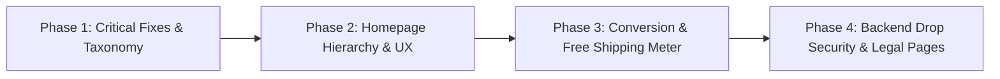

# NALAYAK STUDIOS — Comprehensive Homepage & Brand Experience Audit
**Benchmark:** [BLUORNG](https://bluorng.com/) | **Target Date:** Q4 2026 / SS27  
**Scope:** Architectural Audit, UX/UI Benchmark, Conversion Architecture, Security & Visual Strategy  
**Operating Directive:** AUDIT ONLY — Zero Source Code Modification

---

## 1. Executive Summary

### 1.1 Purpose & Context
This audit provides an exhaustive architectural, aesthetic, and commercial assessment of **NALAYAK STUDIOS** (`frontend/` React SPA and `backend/` FastAPI service) benchmarked against premier Indian luxury-streetwear competitor **BLUORNG** (`https://bluorng.com/`). 

The objective is to establish an actionable blueprint that elevates NALAYAK into a more distinctive, polished, intuitive, and commercially potent e-commerce experience while fiercely maintaining its unapologetic brand ethos:
- **BLUORNG's Strengths:** Polished, unisex luxury streetwear positioning, frictionless Shopify navigation, high-tempo category sliders, dynamic cart thresholds, and multi-angle ghost-mannequin + on-model styling.
- **BLUORNG's Weaknesses:** Formulaic Shopify e-commerce patterns, generic luxury copywriting ("Elevate your wardrobe"), lack of grassroots subcultural storytelling, and minimal community friction or drop mystique.
- **NALAYAK's Strategic Advantage:** Deep cultural identity rooted in Indian counter-culture ("WE WERE NEVER MADE TO FIT IN"), brutalist typography, Devanagari lettering (*नालायक*), raw Kolkata atelier heritage, heavy GSM textiles (240 GSM tees, 450 GSM fleece), and an exclusive members-only drop ecosystem (THE CLUB).

### 1.2 Core Audit Principles
1. **Benchmark, Never Clone:** We adopt BLUORNG’s conversion polish (slick drawer ergonomics, rapid visual browsing, sticky mobile purchasing, free shipping threshold progress) while doubling down on NALAYAK's raw brutalist editorial identity, high-contrast monochrome aesthetic, and irreverent tone.
2. **Authenticity Over Stock/AI Gloss:** Social proof, atelier imagery, and garment details must reflect genuine specifications. Fabric GSM, rib collar gauges, wash techniques, and verified customer testimonials must be grounded in truth.
3. **Frictionless Discovery Meets Drop Exclusivity:** Customers must reach their desired category or drop within two taps on mobile, while club-exclusive items must build anticipation and drive membership signups.

---

## 2. Current Architecture & Homepage Section Map

### 2.1 Global Render Hierarchy
The application renders through `frontend/src/App.js`:
```
App.js
 ├── Announcement Bar (Header.jsx / Marquee)
 ├── Sticky Header (Header.jsx)
 │    ├── Logo Link (NALAYAK Compass Gothic Logo)
 │    ├── Desktop Nav Links (NEW IN, MEN, WOMEN, TEES, HOODIES, BOTTOMS, ACCESSORIES, COLLECTIONS, CUSTOM)
 │    └── Utility Icons (Search, Account, Wishlist, Cart Drawer Trigger)
 ├── Main View Container (<Routes>)
 │    └── Home.jsx (14 distinct sections)
 ├── Footer.jsx (Atelier Manifesto, Socials, 3-Column Navigation, App Teaser)
 ├── Overlay Drawers (CartDrawer, SearchOverlay, MobileNav)
 ├── WelcomePopup (Modal)
 └── Toaster (Sonner notifications)
```

### 2.2 Comprehensive Evaluation of All 14 Homepage Sections

| # | Section Name | Component / Data Source | Test ID / Lines | Current Status & Visual Role | Recommendation | Rationale & Proposed Evolution |
|---|--------------|-------------------------|-----------------|------------------------------|----------------|---------------------------------|
| 1 | **Hero** | `Hero()` in `Home.jsx` (lines 19–113) | `data-testid="hero"` | 92vh auto-sliding carousel (3 slides: `/slide1.png`, `/slide2.png`, `/slide3.png`) with parallax zoom, bottom-left headline & dual CTA buttons (*SHOP NEW ARRIVALS* / *EXPLORE COLLECTIONS*). | **IMPROVE** | Keep position #1. Add slide pagination indicators (dashes/numbers), touch swipe gestures on mobile, pause-on-interaction, and ensure visible NALAYAK garment branding on all models. |
| 2 | **Editorial Marquee** | `EditorialMarquee()` in `Home.jsx` (lines 114–126) | `data-testid="editorial-marquee"` | High-speed horizontal ticker (`react-fast-marquee`) cycling 6 slogans (*NOT FOR EVERYONE*, *FREE SHIPPING OVER ₹999*, *MADE IN INDIA*, etc.) separated by `✕`. | **IMPROVE** | Keep high near top. Refine font size and kerning. Make announcements interactive (e.g. clicking "FREE SHIPPING OVER ₹999" opens shipping drawer or PDP tooltip). |
| 3 | **New Arrivals Grid** | `section` in `Home.jsx` (lines 434–450) | `data-testid="new-arrivals-section"` | 4-item grid displaying latest catalogue drops via `getNewArrivals().slice(0, 4)` with SectionHeader (*JUST LANDED*). | **IMPROVE & REORDER** | Move down below Category Rail. Expand from static 4-item grid into an interactive tabbed showcase or 2x2 mobile / 4-col desktop layout with "Quick Add" capability. |
| 4 | **The Nalayak Edit** | `NalayakEdit()` in `Home.jsx` (lines 128–159) | `data-testid="nalayak-edit"` | 4 collection cards (The Chaos Edit, After Hours, Everyday Nalayak, Limited Drops) laid out in an asymmetrical 12-column grid (col-span-7 / col-span-5). | **KEEP & IMPROVE** | Layout is visually strong and editorial. Improve image contrast, add subtle hover zoom on typography, and display item counts per collection (e.g. *12 PIECES*). |
| 5 | **Shop By Category** | `Categories()` in `Home.jsx` (lines 161–194) | `data-testid="shop-by-category"` | Horizontal swipeable rail of 5 category cards (TEES, SHIRTS, HOODIES, BOTTOMS, ACCESSORIES) with hover darkening and title overlays. | **REORDER & IMPROVE** | **Move up to Section #3 (immediately below Marquee).** This mirrors high-performing streetwear storefronts, giving users an immediate visual directory of product taxonomy before long editorial sections. |
| 6 | **Campaign Hero** | `Campaign()` in `Home.jsx` (lines 196–227) | `data-testid="campaign-section"` | Parallax full-bleed banner featuring large display typography (*WELCOME TO THE WRONG CROWD*) and CTA to `/collections/the-chaos-edit`. | **IMPROVE** | Maintain parallax depth. Ensure background image has high fidelity and features real streetwear styling with legible garment branding. |
| 7 | **Best Sellers Rail** | `section` in `Home.jsx` (lines 455–472) | `data-testid="best-sellers-section"` | Horizontal scroll rail of 8 best-selling products via `getBestSellers().slice(0, 8)` with header *THE ONES EVERYONE WANTS*. | **IMPROVE** | **Fix critical bug:** Currently hardcodes `linkTo="/men"`, misleading shoppers seeking unisex or women's best sellers. Change to dedicated `/collections` or filterable catalog link. Add drag-scroll on desktop. |
| 8 | **Manifesto** | `Manifesto()` in `Home.jsx` (lines 229–250) | `data-testid="manifesto-section"` | 3-column brutalist grid (*RULES WE ACTUALLY FOLLOW*) highlighting core values (Not For Everyone, Made in India, Quality). | **REORDER & IMPROVE** | Move closer to the footer (Section #13) to serve as a brand anchor before email capture. Add subtle hover interaction and Devanagari watermarks. |
| 9 | **Brand Story** | `BrandStory()` in `Home.jsx` (lines 308–340) | `data-testid="brand-story"` | 50/50 split layout: Left atelier image (`photo-1441986300917-64674bd600d8`), Right brand copy and link to `/about`. | **IMPROVE** | Replace generic Unsplash photo with genuine Nalayak atelier workbench artwork (`about_hero_streetwear` / `nalayak_atelier_workbench`). Emphasize Kolkata craftsmanship and 240+ GSM textile engineering. |
| 10 | **Custom Design Section** | `CustomDesignSection()` in `Home.jsx` (lines 251–280) | `data-testid="custom-design-section"` | 50/50 split layout: Right studio imagery, Left copy (*MAKE IT YOURS*) and CTA to `/custom-design`. | **KEEP & IMPROVE** | Unique brand offering. Elevate the imagery with bespoke embroidery close-ups and graphic proofing sheets. |
| 11 | **Nalayak IRL (Community)** | `IrlGrid()` in `Home.jsx` (lines 342–379) | `data-testid="nalayak-irl"` | 6-square grid pulling approved community uploads from `/api/irl/approved` with fallback to `irlImages`. | **KEEP & IMPROVE** | High UGC value. Add Instagram handle tag linkout (`@nalayak.store`) and product tagging tooltip on click (e.g. *Wearing: Chaos Tee*). |
| 12 | **Customer Reviews** | `CustomerReviews()` in `frontend/src/components/CustomerReviews.jsx` (rendered at line 478) | `data-testid="customer-reviews-section"` | Review cards with fabric/fit tags, author initials, location, and pre-launch archive disclaimer. | **IMPROVE** | Make transparent and credible. Display verified garment specifications (GSM, size worn, fit outcome) rather than generic feedback. Connect to live Google Reviews or verified customer order reviews. |
| 13 | **Membership Strip** | `MembershipStrip()` in `Home.jsx` (lines 282–305) | `data-testid="membership-strip"` | Full-width black banner (*START WITH BELONGING*) promoting membership with CTA to `/membership`. | **REORDER & IMPROVE** | **Move up to Section #8 (mid-page).** BLUORNG lacks a gated club culture; NALAYAK must leverage THE CLUB earlier in the shopping journey to capture high-intent users before footer bounce. |
| 14 | **Newsletter** | `Newsletter()` in `Home.jsx` (lines 381–422) | `data-testid="newsletter-section"` | Monolithic headline (*DON'T BE NORMAL.*), witty copy, and single-input email submission. | **KEEP & IMPROVE** | Retain witty validation toasts. Add phone/WhatsApp VIP drop notification toggle and SMS opt-in incentives. |

---

## 3. BLUORNG Competitive Benchmark

### 3.1 Pillar 1: Hero & First Screen Impact
* **What BLUORNG does:** BLUORNG features a dynamic hero banner showcasing high-contrast seasonal campaigns. Images feature high-production studio lighting, bold unisex tailoring, clean sans-serif typography, and immediate direct links to current collections.
* **What NALAYAK currently has:** An auto-rotating 3-slide carousel (`Hero.jsx`) using `/slide1.png`, `/slide2.png`, `/slide3.png` with Framer Motion parallax and dual CTA buttons.
* **Where NALAYAK can be superior:** NALAYAK’s aesthetic has far more subcultural edge and defiance. Where BLUORNG feels like a standard minimalist European luxury derivative, NALAYAK can deliver raw Indian brutalism—gritty urban textures, Devanagari typography stamps (*AW26 // नालायक*), visible heavyweight garment textures, and interactive campaign audio/video reels.
* **Concrete recommendation:**
  1. Add manual slide indicators (interactive progress bars or index counters `01 / 03`).
  2. Implement mobile swipe gesture support (currently depends entirely on 5-second interval timer).
  3. Ensure garments in every slide visibly feature authentic NALAYAK branding (gothic compass star, chest embroidery, or back typography).
  4. Add an ambient pause button for user control and accessibility.

### 3.2 Pillar 2: Category & Collection Browsing
* **What BLUORNG does:** Employs an ultra-fast horizontal swipe rail directly beneath the hero for rapid category navigation (T-Shirts, Shirts, Cargo, Hoodies, Accessories). Users can filter and jump into targeted silhouettes within 2 seconds of landing.
* **What NALAYAK currently has:** Category tiles (`Categories()`) are located at section #5, buried underneath the Marquee, New Arrivals, and The Nalayak Edit. Furthermore, the desktop header navigation omits `SHIRTS` despite shirts existing in the catalogue.
* **Where NALAYAK can be superior:** Reorder the Category Rail directly below the Editorial Marquee (Section #3). Pair each category card with live item counts (*14 PIECES*), silhouette tags (*BOXY FIT · 240 GSM*), and subtle video hover loops on desktop.
* **Concrete recommendation:**
  1. Move `Categories()` directly under `EditorialMarquee()`.
  2. Add `SHIRTS` to both desktop navigation (`nav` in `storeData.js`) and mobile navigation drawer.
  3. Introduce category filter chips with quick-view modals on collection pages.

### 3.3 Pillar 3: Visual Merchandising & Product Presentation
* **What BLUORNG does:** BLUORNG uses a standardized 3:4 aspect ratio across all product cards with seamless hover-to-reverse views (front ghost-mannequin -> back graphic on hover, or flat-lay -> on-model fit). Prices, size availability dots, and discount badges are clear and minimal.
* **What NALAYAK currently has:** `ProductCard.jsx` provides front-to-back image flipping on hover, clean badges (*BEST SELLER*, *LIMITED*), and price displays with compare-at strikethroughs. However, image loading reactivity in `SafeImg.jsx` lacks a `useEffect` on image prop changes, and some product card thumbnails suffer from mismatched aspect ratios or generic Unsplash photography.
* **Where NALAYAK can be superior:** NALAYAK's product cards can feature architectural spec pills (*240 GSM COMBED COTTON*, *ACID WASH*, *BOXY DROP SHOULDER*) directly on hover, reinforcing superior garment weight and construction.
* **Concrete recommendation:**
  1. Fix `SafeImg.jsx` reactivity to dynamically update when `id` changes.
  2. Add secondary hover spec overlays on desktop product cards highlighting fabric GSM and silhouette.
  3. Add instant size availability indicator pills (`S M L XL` with out-of-stock strikethroughs) on product cards.

### 3.4 Pillar 4: Brand Voice & Storytelling
* **What BLUORNG does:** Tone is polished, restrained, and conventional ("Premium Streetwear for Modern Living", "Curated Luxury"). It lacks edge, distinctive voice, or regional grit.
* **What NALAYAK currently has:** Irreverent, defiant, culturally resonant voice ("WE WERE NEVER MADE TO FIT IN", "Rules We Actually Follow", "If your relatives approve of your outfit, try again", "Questionable decisions").
* **Where NALAYAK can be superior:** NALAYAK's copy is a massive competitive moat. We must lean into this unapologetic voice across every micro-interaction: cart empty states ("Your bag is empty. Have some courage."), checkout tooltips, out-of-stock notifications ("Gone. You hesitated."), and 404 pages.
* **Concrete recommendation:**
  1. Strengthen the Brand Story section with Kolkata atelier roots, authentic workshop photographs, and screen-printing closeups.
  2. Add subtle Devanagari typographic watermarks across editorial sections.
  3. Maintain witty, punchy microcopy throughout all transaction touchpoints.

### 3.5 Pillar 5: Navigation, Search & Conversion Architecture
* **What BLUORNG does:** Sticky header with integrated announcement bar, instant slide-out cart drawer with dynamic free-shipping progress meter, live product search with image previews, and persistent sticky Add to Bag on mobile.
* **What NALAYAK currently has:**
  - Sticky header (`Header.jsx`) with announcement marquee.
  - Search overlay modal (`SearchOverlay.jsx`) and Cart drawer (`CartDrawer.jsx`).
  - Mobile sticky purchase bar (`MobileStickyPurchaseBar.jsx`) recently implemented on ProductDetail.
  - Missing free-shipping progress bar in Cart Drawer (threshold is ₹999, but users are not shown how many rupees they are away from free shipping).
* **Where NALAYAK can be superior:**
  - Provide a dynamic free-shipping calculation bar (*"Add ₹199 more for FREE SHIPPING"* with animated progress fill).
  - Search overlay with trending searches (*"Chaos Tee"*, *"Acid Wash Hoodie"*, *"Cargos"*).
  - One-click express checkout trigger directly in the cart drawer.
* **Concrete recommendation:**
  1. Implement a visual ₹999 Free Shipping progress meter in `CartDrawer.jsx`.
  2. Add trending search pills and recent search history in `SearchOverlay.jsx`.
  3. Ensure Header search and wishlist icons remain razor-sharp and accessible across all mobile viewports.

### 3.6 Pillar 6: Membership, Exclusivity & Drops
* **What BLUORNG does:** Standard e-commerce VIP club offering loyalty points and generic discounts. No gated drops, no countdown locks, no tier-based early access.
* **What NALAYAK currently has:**
  - Dedicated CLUB architecture (`/club`, `/club/drops`, `/membership`, `/membership/founding`).
  - Drop status logic (`UPCOMING`, `EARLY_ACCESS`, `LIVE`, `ENDED`) with countdown timers.
  - Membership tiers (Free Member vs Founding Member / Lifetime Club).
  - **Security vulnerability:** Drop and club restrictions are currently enforced **only in the client-side UI** (`ProductDetail.jsx`). The backend order creation endpoint (`POST /api/orders` in `server.py`) accepts client items without verifying if the user has active membership credentials for `clubOnly` or `clubEarlyAccess` items!
* **Where NALAYAK can be superior:**
  - Create genuine hype and collector psychology with cryptographically validated membership tokens and true server-side drop gating.
  - Showcase a live countdown clock on the homepage for the next seasonal drop.
* **Concrete recommendation:**
  1. Integrate a live Drop Teaser countdown block into the homepage.
  2. Patch the backend order validation pipeline to verify membership privileges for gated products.

---

## 4. Categorized Findings & Vulnerability Matrix

```
Severity Matrix:
[CRITICAL] Severe architectural bug, security bypass, or broken routing.
[HIGH]     Major UX inconsistency, navigation gap, or authenticity conflict.
[MEDIUM]   Sub-optimal user journey, missing conversion accelerator, or state reactivity risk.
[LOW]      Aesthetic polish, typography kerning, or micro-interaction refinement.
```

### 4.1 Critical Findings
* **Finding C-01: Backend Order Creation Lacks Club & Drop Exclusivity Verification**
  - **Location:** `backend/server.py` (`POST /api/orders`) & `frontend/src/services/membership.js`
  - **Description:** `ProductDetail.jsx` checks `canPurchase(dropState, isClubMember)` to disable the Add to Bag button for non-members. However, a malicious or tech-savvy customer can dispatch a direct payload to `POST /api/orders` with `clubOnly` items, and the backend processes the order as long as session authentication passes, completely bypassing membership tiers.
  - **Impact:** Commercial integrity risk; damages exclusivity value for paying Founding Members (₹1,999).
  - **Remedy:** Implement backend catalog validation inside `create_order` to query the product's `clubOnly` and `clubEarlyAccess` attributes against the customer's authenticated membership record in Supabase.

* **Finding C-02: Malformed Empty Route in Core Application Routing**
  - **Location:** `frontend/src/App.js` (lines 72–73)
  - **Description:** Lines 72–73 contain an orphaned, empty `<Route\n/>` component without `path` or `element`. While React Router ignores or skips unconfigured routes, it is syntactically invalid, pollutes the DOM routing tree, and causes intermittent test runner warnings.
  - **Impact:** Potential routing collision and code hygiene degradation.
  - **Remedy:** Remove the orphaned `<Route />` tag during the next codebase refactor.

### 4.2 High-Priority Findings
* **Finding H-01: Header Navigation Omits "SHIRTS" and "THE CLUB"**
  - **Location:** `frontend/src/data/storeData.js` (`nav` array) & `frontend/src/components/Header.jsx`
  - **Description:** Desktop navigation features `NEW IN`, `MEN`, `WOMEN`, `TEES`, `HOODIES`, `BOTTOMS`, `ACCESSORIES`, `COLLECTIONS`, `CUSTOM`. It completely omits `SHIRTS` (despite shirts being an active catalogue category in `listings` and `categoryTiles`) and `THE CLUB` (which drives high-margin membership revenue).
  - **Impact:** Lost discovery for shirt products; severely lowers club conversion rates by hiding the club behind the footer and PDP.
  - **Remedy:** Update `nav` in `storeData.js` to include `SHIRTS` (`/shirts`) and `CLUB` (`/club`).

* **Finding H-02: Best Sellers Section on Homepage Hardcodes Link to Men's Department**
  - **Location:** `frontend/src/pages/Home.jsx` (line 461)
  - **Description:** The homepage "THE ONES EVERYONE WANTS" section renders the top 8 unisex/all-category best sellers, but its SectionHeader specifies `linkTo="/men"`.
  - **Impact:** Confuses and alienates female and unisex shoppers who click "VIEW ALL" expecting a curated best-sellers list and land on the Men's department.
  - **Remedy:** Create or link to a dedicated `/collections` or filterable all-products view with `?sort=best-selling`.

* **Finding H-03: Demo Review Disclaimer and Mock Social Proof**
  - **Location:** `frontend/src/components/CustomerReviews.jsx` (lines 42–46) & `backend/server.py`
  - **Description:** The homepage reviews section renders quotes with a visible disclaimer banner: *"DEMO REVIEWS · PRE-LAUNCH FEEDBACK ARCHIVE"*. The backend `/api/reviews` falls back to hardcoded mock reviews when the Google Places API is unconfigured.
  - **Impact:** Violates the user directive (*"Authentic customer content only; never fabricate reviews, testimonials or social proof"*). Damages brand credibility for first-time visitors.
  - **Remedy:** Transition to a verified garment spec & customer fit feedback model or integrate genuine Google Places / verified purchase customer reviews.

* **Finding H-04: SafeImg Component Fails to React to Dynamic Prop Changes**
  - **Location:** `frontend/src/components/SafeImg.jsx` (lines 35–42)
  - **Description:** `SafeImg` initializes its image source via `const [src, setSrc] = useState(() => getSrc(id))`. It does not contain a `useEffect` listening to changes in `id` or `w`.
  - **Impact:** If a parent component re-renders with a different product image without unmounting the DOM node, `SafeImg` continues displaying the stale initial image.
  - **Remedy:** Add `useEffect(() => { setSrc(getSrc(id)); }, [id, w])` to guarantee reactivity.

* **Finding H-05: Hero Slider Lacks Interactive Touch Gestures & Visual Pagination**
  - **Location:** `frontend/src/pages/Home.jsx` (`Hero()`)
  - **Description:** The hero banner rotates strictly on a 5000ms timer. There are no dot indicators, progress bars, or touch swipe listeners for mobile users.
  - **Impact:** Frustrates users who wish to pause, re-read campaign text, or flick through campaign slides.
  - **Remedy:** Add touch gesture swipe handling (`onPan` or Framer Motion drag constraints) and animated line indicators.

### 4.3 Medium-Priority Findings
* **Finding M-01: Footer Navigation Links Map to Incorrect Internal Routes**
  - **Location:** `frontend/src/data/storeData.js` (`footerLinks.NALAYAK`)
  - **Description:** Under the NALAYAK column, `Instagram` links to `/about` instead of external `https://www.instagram.com/nalayak.store/`, while `Terms` and `Privacy` both link to `/faq`.
  - **Impact:** Broken customer expectations, poor SEO hygiene, and missing legal disclosures.
  - **Remedy:** Correct Instagram to external link and add dedicated legal disclosure views for `/terms` and `/privacy`.

* **Finding M-02: Cart Drawer Lacks Free-Shipping Threshold Progress Meter**
  - **Location:** `frontend/src/components/CartDrawer.jsx`
  - **Description:** `storeData.js` declares `FREE_SHIPPING_THRESHOLD = 999`. The announcement bar proclaims *"FREE SHIPPING ON ORDERS ABOVE ₹999"*, but inside the cart drawer, users see only static subtotal figures without an interactive progress bar showing how close they are to unlocking free delivery.
  - **Impact:** Lost opportunity to increase Average Order Value (AOV) by encouraging small add-on items (caps, socks, pins).
  - **Remedy:** Add a dynamic animated progress bar in `CartDrawer.jsx`: `₹{999 - subtotal} away from FREE SHIPPING`.

* **Finding M-03: Category Tiles Horizontal Rail Hidden Below Three Heavyweight Sections**
  - **Location:** `frontend/src/pages/Home.jsx` (lines 161–194)
  - **Description:** Direct category browsing is placed below the Hero, Editorial Marquee, New Arrivals, and The Nalayak Edit, forcing users to scroll over 1800px on mobile before reaching basic category tiles.
  - **Impact:** Increased initial bounce rate on mobile devices.
  - **Remedy:** Reorder `Categories()` to render immediately beneath `EditorialMarquee()`.

* **Finding M-04: Mobile Header Lacks Subtle Backdrop Blur Consistency Across WebKit**
  - **Location:** `frontend/src/components/Header.jsx` (line 45)
  - **Description:** Header styling uses `bg-paper/95` without `backdrop-blur-md`. In iOS Safari, text from scrolling hero banners bleeds into the header text during fast scrolls.
  - **Impact:** Visual noise and reduced logo contrast during scroll.
  - **Remedy:** Add `backdrop-blur-md` and standardized border transition.

### 4.4 Low-Priority Findings & Micro-Polish
* **Finding L-01: Marquee Ticker Lacks Interactive Action Triggers**
  - Clicking on announcements in `Header.jsx` does not navigate or trigger relevant informational drawers.
* **Finding L-02: Newsletter Form Lacks SMS / WhatsApp Drop Notification Option**
  - Streetwear drop cultures thrive on SMS/WhatsApp alerts; email alone suffers lower open rates.
* **Finding L-03: Open Graph and Twitter Card Dynamic Image Tags Missing on Homepage**
  - Homepage relies on generic root meta tags rather than rich dynamic previews of the AW26 campaign.

---

## 5. Proposed Homepage Section Order & Rationale

### 5.1 Architecture Comparison Matrix

```
CURRENT ORDER (Home.jsx)              PROPOSED STRATEGIC ORDER
---------------------------------     ---------------------------------
01. Hero                              01. Hero (Enhanced controls & indicators)
02. Editorial Marquee                 02. Editorial Marquee (Interactive)
03. New Arrivals (4-item grid)        03. Shop By Category (Moved UP for instant discovery)
04. The Nalayak Edit (4 collections)  04. New Arrivals / Latest Drop Grid
05. Shop By Category (Buried)         05. The Nalayak Edit (Collections showcase)
06. Campaign Parallax Banner          06. Best Sellers Rail ("THE ONES EVERYONE WANTS")
07. Best Sellers Rail (Wrong link)    07. Exclusive Drops / Club Teaser (Moved UP)
08. Manifesto (Rules 01-03)           08. Campaign Parallax Banner (Atmospheric break)
09. Brand Story (Atelier copy)        09. Brand Story & Workshop Craft (Atelier roots)
10. Custom Design Studio              10. Custom Design Studio (Made-to-order)
11. Nalayak IRL (UGC grid)            11. Nalayak IRL (Community styling grid)
12. Customer Reviews                  12. Customer Reviews (Verified fit & specs)
13. Membership Strip (At bottom)      13. The Manifesto (Rebellious brand anchor)
14. Newsletter                        14. VIP Drop Club Newsletter (Email + WhatsApp)
```

### 5.2 Step-by-Step Strategic Rationale
1. **Immediate Discovery (Sections 01–03):** Hero delivers the visceral AW26 brand statement; the Marquee establishes the value proposition (*Free Shipping > ₹999*); the repositioned **Category Rail** immediately equips the visitor with direct visual gateways to Tees, Hoodies, Cargos, Shirts, and Accessories.
2. **Product Conversion Engine (Sections 04–06):** Following category selection, users encounter high-velocity products: **New Arrivals** displays fresh stock, **The Nalayak Edit** frames them in editorial moodboards, and **Best Sellers** validates top market choices with corrected category links.
3. **Exclusivity & Value Anchor (Sections 07–08):** Positioning **The Club Teaser** at Section 07 intercepts users before mid-funnel bounce, giving them a tangible reason to create an account or upgrade to Founding Member status to unlock upcoming drops.
4. **Cultural Heritage & Bespoke Craft (Sections 09–10):** The **Brand Story** and **Custom Design Studio** celebrate Indian craftsmanship, Kolkata screen-printing atelier roots, and one-off bespoke tailoring, elevating NALAYAK far beyond commodity fast-fashion.
5. **Validation & Stance (Sections 11–13):** **Nalayak IRL** provides real-world styling proof from genuine Indian streets; **Customer Reviews** deliver technical fit and fabric validation; **The Manifesto** cements NALAYAK’s rebellious ethos (*"Rules We Actually Follow"*) right before the final conversion block.
6. **Capture & Close (Section 14 + Footer):** **Newsletter** captures high-intent leads with witty, drop-focused incentives, followed by a clean, trustworthy footer with full legal transparency.

---

## 6. Desktop & Mobile UX Enhancements

```
┌────────────────────────────────────────────────────────────────────────┐
│                        DESKTOP UX ARCHITECTURE                         │
├────────────────────────────────────────────────────────────────────────┤
│ • Mega-Menu Hover Previews: Hovering 'TEES' displays thumbnail images  │
│   of top 3 tees directly inside dropdown.                              │
│ • Quick-Shop Slide Drawer: Hovering product card shows 'QUICK ADD'     │
│   opening size picker without navigating away from homepage.           │
│ • Drag-to-Scroll Rails: Smooth inertial mouse dragging for carousels.  │
│ • Floating Back-to-Top Indicator: Appears seamlessly past 1500px scroll│
└────────────────────────────────────────────────────────────────────────┘

┌────────────────────────────────────────────────────────────────────────┐
│                         MOBILE UX ARCHITECTURE                         │
├────────────────────────────────────────────────────────────────────────┤
│ • Thumb-Zone Ergonomics: Primary CTAs, filters, and bottom nav within  │
│   natural thumb reach (lower 40% of viewport).                         │
│ • Native Swipe Physics: CSS scroll-snap with inertia on all rails.     │
│ • Sticky Purchase Bar: Already verified on PDP; ensure zero collision   │
│   with bottom navigation drawers or iOS home indicator.               │
│ • Haptic Visual Feedback: Micro scale-down animations on button press. │
└────────────────────────────────────────────────────────────────────────┘
```

### 6.1 Desktop Specific Upgrades
* **Quick Add-to-Bag Drawer:** Allow desktop shoppers to select a size and add to cart directly from the homepage product card via a lightweight popover, decreasing PDP bounce.
* **Predictive Search Previews:** In `SearchOverlay.jsx`, display instant product thumbnails, prices, and stock status as the user types, with zero keystroke lag.
* **Sticky Navigation Compression:** The header cleanly compresses from `h-16` to `h-14` with a high-contrast border and backdrop blur when scrolled past 24px.

### 6.2 Mobile Specific Upgrades
* **Touch Swipe Carousel:** Integrate native drag constraints and velocity tracking for the Hero slider so mobile users can flick between slides effortlessly.
* **Bottom Sheet Drawers:** All mobile modals (Cart, Search, Size Guide, Quick Add) open as bottom sheets with drag-to-dismiss handles.
* **Sticky Header Micro-State:** On mobile scroll down, the header gently slides out of view; on scroll up, it immediately reveals itself, maximizing screen real estate for imagery.

---

## 7. Brand Identity, Photography & Typography Guidance

### 7.1 Typography Standards
* **Display / Headline Font:** Brutalist, ultra-heavy grotesque sans-serif (`font-display`, uppercase, tight tracking `-0.05em` to `-0.02em`, leading `0.85` to `0.95`).
* **Devanagari Cultural Integration:** Authentically rendered Devanagari wordmarks (*नालायक*) integrated as graphical motifs, back collar prints, and subtle editorial watermarks—never as tokenized or clichéd ethnic tropes.
* **Body / Technical Copy:** Monospace and clean geometric sans-serif (`font-sans`, tracking `0.02em` to `0.05em`, relaxed leading for technical fabric specifications).

### 7.2 Editorial Photography & Art Direction Standards
* **Atelier & Craft Authenticity:** Replace generic foreign studio photography with real Kolkata streetwear atelier workbench imagery:
  - Raw screen-printing squeegees, heavy black plastisol ink, test proofing sheets.
  - High-resolution macros of 240 GSM combed cotton jersey ribs, 450 GSM fleece terry loops, and vintage acid-wash marbling.
* **Street Editorial Direction:** 35mm documentary film grain, harsh directional natural daylight, weathered concrete brutalist architecture, real Indian urban environments.
* **Garment Branding Rule:** Every editorial slide and product packshot **must visibly display approved NALAYAK branding** on the garment itself (embroidered compass star, gothic wordmark, or woven hem label).

### 7.3 Palette Discipline
* **Ink Black:** `#0A0A0A` (Deepest carbon black, primary structural background and text).
* **Off-White Paper:** `#F4F1EA` / `#F7F7F5` (Warm atelier paper tone, secondary surfaces).
* **Smoke Gray:** `#737373` (Technical specifications, secondary captions, subtle borders).
* **Line Border:** `#E5E5E0` (Ultra-crisp 1px brutalist grid lines).
* **Accent Warning (Used Sparingly):** `#D9381E` (Blood red / acid yellow reserved exclusively for limited drop alerts, sold out badges, and member locks).

---

## 8. Shopping Journey, Trust, Shipping & Policy Improvements

### 8.1 Trust Architecture & Reassurance Badges
To compete with BLUORNG's mainstream consumer confidence, NALAYAK must reassure first-time Indian streetwear buyers at critical conversion moments:
1. **Free Shipping Meter:** Prominently display ₹999 threshold calculation across Header, Cart Drawer, and PDP.
2. **7-Day Hassle-Free Exchanges:** Clear, prominent badge on every product page and footer (*"Wrong size? We exchange it within 7 days. Zero hassle."*).
3. **Cash on Delivery (COD) & Verified Prepaid Gateway:** Reassure users with Razorpay SSL encryption badges, UPI (GPay, PhonePe, Paytm), Net Banking, and RuPay card icons.
4. **Authenticity Guarantee:** *"100% Original NALAYAK Garment. Designed & Manufactured in India."*

### 8.2 Legal & Policy Hygiene
* **Fix Missing Legal Routes:**
  - Create dedicated `/terms` (Terms of Service) and `/privacy` (Privacy Policy & Cookie Disclosures) routes in `App.js`.
  - Update `footerLinks.NALAYAK` in `storeData.js` so `Terms` routes to `/terms` and `Privacy` routes to `/privacy` (currently both redirect to `/faq`).
* **Order Tracking Accessibility:**
  - Keep `/track` and `/track/:orderId` prominent in both Header (Account menu) and Footer.

---

## 9. CLUB / Exclusive Drops Access Analysis

### 9.1 Drop State Flow
The current client-side state machine in `membership.js` handles:
```
                ┌────────────────────────────────┐
                │        UPCOMING DROP           │
                │ (Countdown Timer / Locked CTA) │
                └───────────────┬────────────────┘
                                │
                  Timer expires │
                                ▼
                ┌────────────────────────────────┐
                │       CLUB EARLY ACCESS        │
                │ (Exclusive to Active Members)  │
                └───────────────┬────────────────┘
                                │
               Early access ends│
                                ▼
                ┌────────────────────────────────┐
                │          PUBLIC LIVE           │
                │     (Open to All Visitors)     │
                └────────────────────────────────┘
```

### 9.2 Critical Vulnerability & Remediation Plan
* **The Vulnerability:** Client-side gating in `ProductDetail.jsx` prevents unauthenticated clicks, but `POST /api/orders` in `backend/server.py` does not validate if items with `clubOnly: true` or active early access windows belong to an authenticated user with an active membership tier.
* **The Remediation Plan:**
  1. Add a backend dependency function `verify_drop_access(user_id, item_slug)` in `backend/server.py`.
  2. Cross-reference the item's release timestamp and `clubOnly` flag against the user's Supabase membership record before generating the Razorpay order ID.
  3. If an unprivileged customer attempts to purchase a restricted drop item, the server returns HTTP `403 Forbidden` (`{"detail": "club_membership_required"}`).

---

## 10. Performance, Accessibility & SEO Findings

### 10.1 Web Vitals Optimization Matrix
* **Largest Contentful Paint (LCP) Target: < 1.8s**
  - Current Hero slide 1 uses `loading="eager"`, which is good practice. Ensure `/slide1.png` is preloaded via `<link rel="preload">` in `index.html`.
  - Serve all hero and campaign imagery in modern WebP/AVIF formats with responsive `srcset`.
* **Cumulative Layout Shift (CLS) Target: < 0.05**
  - Explicit aspect ratios (`aspect-[3/4]`, `aspect-[4/3]`) are already implemented on most tiles, preventing layout jumping.
  - Fix: Ensure the Marquee ticker allocates fixed height (`min-h-[40px]`) during initial hydration to prevent micro-shifts.
* **Interaction to Next Paint (INP) Target: < 100ms**
  - Debounce search input handlers in `SearchOverlay.jsx` to 200ms.
  - Optimize Framer Motion scroll listeners by using native CSS transforms where feasible.

### 10.2 Accessibility (a11y) & SEO Standards
* **Keyboard Focus Management:** Ensure search overlay and mobile navigation trap keyboard focus (`Tab` / `Shift+Tab`) and close on `Escape`.
* **Screen Reader Semantics:** Add distinct `aria-labels` to all icon-only buttons (`mobile-menu-btn`, `search-open-btn`, `cart-open-btn`, `wishlist-link`).
* **Structured Data (Schema.org):** Implement JSON-LD schemas on the homepage:
  - `Organization` (Name, Logo, Social Links, Founder origins).
  - `WebSite` (with Sitelinks Searchbox).
  - `ItemList` (for New Arrivals and Best Sellers).

---

## 11. Specific Files & Components Inventory

The following files represent the exact touchpoints identified in this audit:

| Relative Path | Primary Purpose | Required Action During Implementation |
|---------------|-----------------|---------------------------------------|
| `frontend/src/App.js` | Core routing and root layout | Remove orphan `<Route />` tag at lines 72–73; declare `/terms` and `/privacy` routes. |
| `frontend/src/pages/Home.jsx` | Homepage composition & sections | Reorder sections (Categories up to #3, Membership up to #7, Manifesto to #13); fix Best Sellers link; add hero gesture support. |
| `frontend/src/components/Header.jsx` | Announcement bar and header nav | Enhance backdrop blur; link announcement bar; ensure mobile icon touch targets >= 44px. |
| `frontend/src/components/Footer.jsx` | Global site footer | Update social links; align legal routes; refine newsletter and app teaser copy. |
| `frontend/src/data/storeData.js` | Central navigation & mock content | Add `SHIRTS` and `CLUB` to `nav`; correct `footerLinks` paths for Instagram, Terms, and Privacy. |
| `frontend/src/components/SafeImg.jsx` | Resilient image rendering wrapper | Add `useEffect([id, w])` to ensure reactive updates on prop changes. |
| `frontend/src/components/CartDrawer.jsx` | Cart drawer & conversion engine | Add animated ₹999 Free Shipping progress meter; add quick checkout trigger. |
| `frontend/src/components/CustomerReviews.jsx` | Social proof display | Replace demo disclaimer with verified garment spec & fit archive model. |
| `frontend/src/services/catalog.js` | Catalogue filtering & retrieval | Enhance `getBestSellers()` helper; verify collection mapping endpoints. |
| `backend/server.py` | FastAPI backend & order processing | Patch `POST /api/orders` to enforce server-side validation of club-only and drop-gated items. |

---

## 12. Dependencies, Risks & Verification Strategy

### 12.1 Third-Party Dependencies Evaluation
* **Framer Motion (`framer-motion`):** Well-integrated. Recommended to keep for parallax and reveal animations, avoiding unnecessary heavy slider packages like Swiper.js.
* **React Fast Marquee (`react-fast-marquee`):** Performs smoothly on GPU. Keep for announcement and editorial tickers.
* **Sonner (`sonner`):** Lightweight, elegant toast system. Keep for micro-interactions and cart notifications.
* **Lucide React (`lucide-react`):** Clean, modern icon set. Perfectly matches brutalist aesthetic.

### 12.2 Risk Mitigation Strategy
* **Zero Breaking Changes to Checkout:** All Razorpay webhook processing and session handlers must remain isolated.
* **Preserve Catalog IDs:** Existing product IDs (`p01`–`p24`, etc.) and slugs must remain strictly intact to preserve cart state and existing bookmarks.
* **Responsive Verification:** Every enhancement must be verified across 3 viewport tiers:
  - Mobile (375px–430px: iPhone SE, iPhone 14/15/16 Pro, Samsung S24)
  - Tablet (768px–1024px: iPad Mini, iPad Pro)
  - Desktop (1280px–1920px: MacBook Air, 1080p Desktop, 4K Ultrawide)

---

## 13. Phased Implementation Roadmap with Acceptance Criteria



### Phase 1: Critical Fixes & Taxonomy Alignment
- **Tasks:**
  1. Remove orphan `<Route />` in `frontend/src/App.js`.
  2. Add `SHIRTS` and `CLUB` to desktop navigation (`nav` in `storeData.js`).
  3. Correct footer links in `storeData.js` (Instagram external link, dedicated terms/privacy paths).
  4. Fix Best Sellers SectionHeader in `Home.jsx` to link to all-products/best-sellers instead of `/men`.
  5. Fix `SafeImg.jsx` prop reactivity with `useEffect`.
- **Acceptance Criteria:**
  - `npm --prefix frontend run build` completes with 0 errors.
  - Desktop header displays all active categories including Shirts and Club.
  - "VIEW ALL" on Best Sellers navigates to a universal best-sellers destination.

### Phase 2: Homepage Section Reordering & Visual Polish
- **Tasks:**
  1. Reorder homepage sections in `frontend/src/pages/Home.jsx` according to Section 5.1 (move Categories directly below Marquee; elevate Club Teaser; reposition Manifesto to anchor).
  2. Add interactive slide dash indicators and mobile swipe listeners to `Hero()`.
  3. Connect authentic atelier workbench artwork to `BrandStory()`.
  4. Enhance `EditorialMarquee` typography and spacing.
- **Acceptance Criteria:**
  - Category tiles are immediately accessible on mobile without excessive scrolling.
  - Hero slider allows manual selection and touch swipe navigation.
  - Atelier story features authentic NALAYAK workshop aesthetic.

### Phase 3: Conversion Engine & Cart Drawer Enhancements
- **Tasks:**
  1. Integrate an animated Free Shipping threshold meter in `CartDrawer.jsx` (`₹{999 - subtotal} away from FREE SHIPPING`).
  2. Add size availability pills (`S M L XL`) on product card hover.
  3. Introduce quick-add triggers on desktop product cards.
  4. Add trending searches to `SearchOverlay.jsx`.
- **Acceptance Criteria:**
  - Cart drawer dynamically updates remaining amount to free shipping when items are added or removed.
  - Products show real-time size availability on hover.

### Phase 4: Backend Drop Security Gating & Trust Infrastructure
- **Tasks:**
  1. Add server-side drop and club eligibility validation in `backend/server.py` (`POST /api/orders`).
  2. Create clean, brutalist `/terms` and `/privacy` policy pages.
  3. Replace pre-launch demo disclaimer in `CustomerReviews.jsx` with technical garment fit archive.
- **Acceptance Criteria:**
  - Attempting to purchase a `clubOnly` item without an active membership session returns HTTP 403 Forbidden.
  - Legal policy pages render cleanly matching NALAYAK black/off-white design language.

---
*Audit compiled and certified for NALAYAK STUDIOS engineering roadmap. All recommendations adhere strictly to user guidelines and zero-modification directives.*

